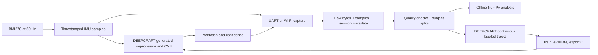

# Wearable movement classification

**Target: belt-mounted walking, sprinting, jumping, biking, driving and fall
detection, with a cancellable local alert.** See
[belt and fall design](belt-fall-detection.md) for the six-axis training profile,
LED/button behavior and event evaluation. The wrist model below is a legacy
reference, not the trained belt classifier.

This workspace contains two separate Git repositories: `workingDir/` is the
PSoC firmware, and `analysis/` is the offline data pipeline. The parent directory
also holds the existing `DeepCraft/IMUexample` project and its trained `.h5`.

## What is implemented

- 50 Hz BMI270 capture with all six physical IMU channels retained.
- A DEEPCRAFT streaming Queue API adapter with explicit input units, output
  names, confidence handling, and reset on sampling discontinuities.
- Optional IMU-only wearable task configuration, and task-safe button control.
- A latched LED2 fall indicator with button/CLI cancellation, cooldown and
  separate alert/cancel/test log events.
- Shared UART/TCP capture tools, raw evidence, labeled session metadata,
  checksums, quality reports, grouped splits, NumPy windows, and Studio tracks.

**Actual classification remains disabled until a generated C model is supplied
and validated.** No prediction is fabricated. The `.h5` alone is not the C
library expected by this firmware. Battery runtime and recognition accuracy in
the printed enclosure have not been measured.



## Model contract: use the files, not the old comments

The existing `DeepCraft/IMUexample/IMUexample.improj` specifies a Conv1D model
with input `[50,3]`, sliding window 50, stride 30. The saved
`conv1d-medium-balanced-3_preprocessor_and_network_test_output.data` header has
**six** outputs in this order:

| ID | Name |
| --- | --- |
| 0 | standing |
| 1 | running |
| 2 | walking |
| 3 | sitting |
| 4 | jumping |
| 5 | unlabeled |

Its example input has acceleration magnitudes near 1 at rest, suggesting g.
The adapter therefore defaults to `(ax, ay, az) / 9.80665`; **verify this against
the actual export and its test vectors before enabling it**. Gyroscope data is
preserved in recordings but is not an input to this three-channel model.
For a newly trained six-channel CNN, update the contract to six inputs in order
`ax,ay,az,gx,gy,gz` with units `g,g,g,deg/s,deg/s,deg/s` on both sides.

The current driver uses +/-4 g, +/-2000 deg/s, and polls a sensor configured at
200 Hz every 20 ms. The starter README describes +/-8 g and +/-500 deg/s. Those
are different acquisition conditions. Retrain/evaluate with the actual hardware
configuration, or deliberately change both register settings and conversion
constants in `bmi270.c/.h`. Do not change one without the other. Current capture
is polling, not a hardware-timestamped FIFO; measure jitter with logging and
inference running together before claiming precise 50 Hz timing.

## Firmware build and deployment

From `workingDir/` in ModusShell:

```sh
# Existing multisensor/Wi-Fi acquisition behavior, no deployed model
make build

# IMU, logger, button, CLI and flash tasks; no auxiliary sensors or Wi-Fi task
make build WEARABLE_PROFILE=1
```

The profile reduces active tasks; it is not a completed low-power design. Wi-Fi
libraries still link, and no sleep policy or battery management has been added.
For wireless collection use the default build. Radar remains disabled by the
existing `ENABLE_RADAR` switch.

To deploy a CNN:

1. Collect labeled recordings in the final mounting and enclosure. Use the
   companion `analysis/README.md` workflow. Choose the intended classes first;
   the five named activities above are only the existing starter taxonomy.
2. Prepare grouped data. In Studio import the continuous `data.csv` / `.label`
   pairs. Preserve the assigned train/validation/test directories; don't let
   Studio randomly redistribute overlapping windows or recordings by subject.
3. Train a Conv1D classifier in DEEPCRAFT, starting from the existing project
   if appropriate. Match 50 Hz, the channel order, physical units, window and
   stride. Keep test participants out of model selection. Include realistic
   transitions/background examples; do not substitute model predictions for
   human ground truth.
4. Evaluate per-class precision/recall and confusion matrix, including sitting
   versus standing, subject variation, strap looseness and orientation. Choose
   a confidence threshold on validation data; the adapter's 0.70 is provisional.
5. Generate a self-contained C export **including preprocessing**, with the
   `IMAI_` prefix and **Queue API without timestamps**. Place `model.c`, `model.h`
   and required export dependencies under `source/ml/generated/`.
6. Verify `activity_model_config.h`: class count/order, axes, units, input count,
   probabilities, and sample cadence. Replay the supplied input/output vectors
   against the export. The API currently expects `int IMAI_init(void)`, enqueue
   and dequeue; older void-init exports or callback/time APIs need adaptation.
7. Build with `make build WEARABLE_PROFILE=1 ACTIVITY_MODEL_ENABLED=1
   ACTIVITY_MODEL_CONTRACT_VERIFIED=1` (one line). Measure worst-case inference
   time, queue gaps, stack/RAM use, and live accuracy before flashing for field use.

Firmware enqueues each sample exactly once and lets the generated preprocessor
manage overlap. It rejects nonfinite inputs and invalid probabilities. Gaps,
duplicates and model API errors reset temporal state; the model warms up again.
Low confidence produces `unknown`, distinct from the trained `unlabeled` output.
UART/TCP predictions older than one second are left blank. The human recording
`label` remains separate from `ml_class` / `ml_conf`.

Official API reference: [DEEPCRAFT Edge API](https://developer.imagimob.com/deepcraft-studio/deployment/edge-api).
Studio data import: [Adding data to a project](https://developer.imagimob.com/deepcraft-studio/data-preparation/add-data-to-project).

## Enclosure and collection protocol

Before printing, measure the actual PCB, connectors, button travel, component
heights and mounting holes. This change does not invent board dimensions or
produce CAD. Design for these requirements:

- A rigid board mount and repeatable strap attachment: movement inside the
  enclosure changes the training signal. Mark the board axes and body-facing
  side on the shell. Record side of body and orientation on every capture.
- Access to the recording button, LED, USB/programming port and reset. Provide
  cable strain relief and room for connectors, not just the bare PCB outline.
- Keep the radio antenna area clear when using Wi-Fi; follow the kit mechanical
  and antenna guidance when fixing placement. Leave relevant sensor openings
  accessible if you later enable the microphone or pressure sensor.
- Record an enclosure revision whenever fit, strap, location or orientation
  changes. Recollect held-out recordings after any mechanical change.
- Decide the power source and attachment together. Battery integration, charging,
  thermal testing and runtime measurements are separate unfinished hardware work.

Use short, single-activity captures initially (for example 30-60 seconds), with
separate start/stop boundaries. Record multiple takes across different days and
subjects, including natural transitions in dedicated labeled captures. Keep the
printed shell and strap consistent. Reserve entire participants for evaluation
where possible; for a personal-only device, use recording/session splits across
days and clearly limit the generalization claim.

## Flash logging limitations

Use UART or TCP sessions as the verified route into the offline pipeline for
now. The pre-existing flash v1 format is **experimental**, despite the earlier
documentation describing it as durable:

- `next_slot` is checkpointed at starts/sector events, not clean stops; abrupt
  power loss can hide tail records and the next boot can attempt writes onto
  already-programmed NOR flash.
- The packed record stride does not divide the sector size, while sector erase
  selection assumes sector-aligned groups. Long recordings need a versioned
  layout fix and an explicit migration/export strategy for existing contents.
- Records have no CRC; dump/erase and the background writer lack a full
  synchronization protocol. A stopped recording does not imply the queue has
  drained or been committed.

The new dump output preserves existing session markers for host import; it
does not change stored flash bytes or claim power-loss recovery. Export existing
data before any future flash-format migration. Before board-only untethered
collection, implement and fault-test a versioned CRC journal, bounded overflow
reporting, serialized dump/erase, and acknowledged flush/checkpoint at stop.

## Validation

The offline suite exercises current and legacy schemas, corruption, fragmented
streams, timestamp discontinuities, integrity checks, label mismatches, duplicate
sources, grouped splits and unit conversion. A host C test uses a mock generated
API to exercise the firmware adapter. It is not an accuracy test of the CNN.

```sh
# analysis/, with requirements installed
python -m unittest discover -s tests -v

# workingDir/, with a host GCC (not the ARM compiler)
gcc -std=c11 -Wall -Wextra -Werror -DACTIVITY_MODEL_ENABLED=1 -DACTIVITY_MODEL_CONTRACT_VERIFIED=1 -Itests/stubs -Isource/ml -Isource/drivers tests/test_activity_model.c source/ml/activity_model.c -o build/test_activity_model
```

Hardware tests still required: sustained 50 Hz with inference enabled, transport
loss detection, physical button start/stop, exported-model parity, mounting
accuracy, enclosure fit and battery runtime. No board was programmed by this change.
